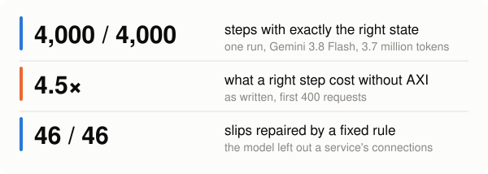
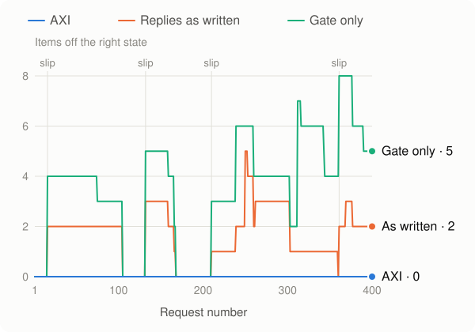
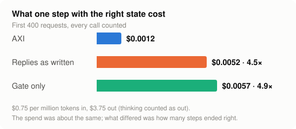

<h1 align="center">AXI Runtime</h1>

<p align="center"><b>The model was right 98% of the time. Applied as written, only 21% of its steps ended with the right state.<br>With AXI between the model and the state: every one of them.</b></p>

<p align="center"><sub>First 400 requests of the same stream, three ways of keeping the state. The whole run was 4,000 requests.</sub></p>

<p align="center"><a href="https://github.com/gaurshalendra2412/axi-runtime/actions/workflows/ci.yml"></a></p>

<p align="center">
<picture>
<source media="(prefers-color-scheme: dark)" srcset="docs/img/headline-numbers-dark.svg">

</picture>
</p>

<p align="center">
<picture>
<source media="(prefers-color-scheme: dark)" srcset="docs/img/headline-distance-dark.svg">

</picture>
</p>

**Why a model that is right 98% of the time can leave the state right on only 21% of the steps:** a slip that nothing catches stays in the state, and every later step builds on it. In these 400 requests the model slipped 7 times (393 replies right, 98%). Four of those slips, marked on the chart, each started a stretch in which the state was wrong, and together those stretches covered 315 of the 400 steps. The gate refuses bad replies, so it never held a broken state, but its state was off the right one from step 210 to the end. AXI's line is flat at zero.

---

## What AXI is

A small runtime between an AI agent and the state it edits. The model proposes one change at a time. AXI checks the change against the rules, completes what the rules can complete, commits it all or not at all, and then shows the model the exact state again. The point is to stop small errors from compounding over long, multi-step agent runs.

The idea, the framework and the architecture are **Rajnish Choubey's**. This repository holds the code, tests and measurements that implement and check them. See [Credits](#credits).

## The run, in plain words

One model (Gemini 3.8 Flash), one job (editing a service graph of 17 to 22 services on average), one run of **4,000 requests in a row**, 3.7 million tokens sent in all.

* **With AXI keeping the state, it was exactly right at 4,000 of 4,000 steps** and never corrupted. The prompt stayed about the same size (1.16 times from the first tenth of the run to the last) and the speed did not fall (0.94 times).
* **The model itself is good:** its reply was right 3,954 times out of 4,000 (98.85 percent). All 46 slips were of one kind. Asked to "delete a service and also remove this edge", it left out the service's other connections. A fixed, rule-based repair completed all 46.
* **The same slips, applied as written, did real damage.** On the first 400 requests of the same stream, the replies applied as written left the state exactly right on 85 steps of 400 (21 percent) and corrupted it on 223 (56 percent). Once a slip got in, the state stayed wrong for 36 to 150 steps at a time (the last stretch was still going when the 400 steps ended).
* **A gate that only refuses bad replies** kept the state well formed (never corrupted) but did not make it right: exactly right on 84 of 400, and off the right state on every step from 210 to 400.

## What it cost

The spend was about the same for all three ways of keeping the state. What differed was how many steps ended with the right state, so what one right step cost differed too:

<p align="center">
<picture>
<source media="(prefers-color-scheme: dark)" srcset="docs/img/cost-per-right-step-dark.svg">

</picture>
</p>

| First 400 requests | Steps with the right state | Spent | Cost of one step with the right state |
|---|---|---|---|
| AXI (repair + scope filter) | 400 | $0.47 | $0.0012 |
| Replies applied as written | 85 | $0.45 | $0.0052 (4.5 times as much) |
| Gate only (refuses bad replies) | 84 | $0.48 | $0.0057 (4.9 times as much) |

Priced at $0.75 per million tokens in and $3.75 out (thinking counted as out), every call counted. The cost column was worked out from the saved files after the results were read, so it is not one of the pre-written reading rules.

**What this does not show.** It is one sampled run on one model and one job; a repeat would give different numbers, and the second run has not been made. The repair rule (a deleted service takes its dependants with it) is the job's own rule, and the model was never told it, so this shows the layer works when the rule is known, not that it can find rules. We did not measure an agent that reads its state back and corrects itself, or energy (a chat that keeps its history is measured in the section below).

Full page, every number, and what it does not show: [`docs/MILLION_TOKEN_TEST_HARD.md`](docs/MILLION_TOKEN_TEST_HARD.md).

### Earlier results on smaller models

* Qwen2.5-3B, four seeds, 60 tasks each, no rule in the prompt: applying the model's (grammar-constrained) output as written corrupted the graph on 120 of 120 "delete a service that still has dependants" tasks. With the gate, corruption was 0. Deterministic repair got every task right on all four seeds (240 of 240).
* Qwen2.5-7B, 30 requests in a row: applying as written corrupted the state in 12 of 12 episodes. The gate corrupted it in 0 of 360 steps.

Both are on synthetic service graphs, in Colab. The tables and what is still open are in [`docs/VERIFIED.md`](docs/VERIFIED.md) and [`docs/EXPERIMENT_RESULTS.md`](docs/EXPERIMENT_RESULTS.md).

<!-- long-session:start -->
## The long session, with and without AXI (22 Oct 2026)

The same model (Gemini 3.8 Flash), a long job with heavy turns (every request came with about 40 lines of operations log), once with AXI holding the state (1,500 steps) and once with the whole chat kept (457 turns, up to 949,591 tokens).

| | Without AXI (chat kept) | With AXI |
|---|---|---|
| Prompt tokens sent per step | 476,835 | **2,824** (169 times fewer) |
| Tokens sent in all | 217.5 million (457 turns) | **4.6 million** (1,500 steps; 47 times fewer) |
| State held, exact | until turn 286; wrong on every turn after | **1,500 of 1,500 steps, 0 corrupted** |
| Distance of the held state from the true state | up to 17 items | **0 at every step** |
| First token, median | 2.23 s at best, 9.13 s past 500,000 tokens | **2.27 s, flat** |
| Seconds a step | 7.13 | **3.07** (2.3 times faster) |
| Exact steps an hour | 488 | **1,157** (2.4 times more) |
| Thinking tokens a step | 77 early, 239 late | **no climb: 210 early, 247 late** |

One run of each arm on one job. The page for a company that runs the model: [`docs/AXI_FOR_COMPANIES.md`](docs/AXI_FOR_COMPANIES.md). The full page with its pre-written reading rules and every table: [`docs/GEMINI_LONG_TEST.md`](docs/GEMINI_LONG_TEST.md).
<!-- long-session:end -->

<!-- fuzzy-and-arc:start -->
## For a company that runs the model: three more runs, and the whole picture (22 to 24 Oct 2026)

Gemini 3.8 Flash again, on three jobs that are not the dependency graph of the long session: a **400-turn conversation in plain, ambiguous sentences** (Test 23), **four ARC-AGI-3 games** (Test 24) and the same games **with a host-owned explorer** (Test 25). Each job was run once with the chat kept and once with AXI holding the state. The pages with their pre-written reading lines are in [`docs/`](docs/); every figure below is recomputed from the saved files by `python/tests/test_arc_fuzzy_results.py`. The full technical account is [`docs/AXI_TECHNICAL_REFERENCE.md`](docs/AXI_TECHNICAL_REFERENCE.md).

### Where AXI changes the numbers

| What a company counts | Without AXI (chat kept) | With AXI | Run |
|---|---|---|---|
| Prompt tokens sent a step, conversation job | 99,809 on average, 188,806 by the end | **1,177** (85 times fewer) | Test 23 |
| Tokens sent in all, conversation job | 39.9 million | **0.53 million** (76 times fewer) | Test 23 |
| Tokens sent in all, four ARC games | 25.7 million | **1.95 million** (13.2 times fewer) | Test 24 |
| The list a firm holds if it applies each reply as it comes | exact on 65.0 % of the turns: one wrong change at turn 191 stayed for **140 turns** | **exact on 400 of 400 steps**, distance 0 | Test 23 |
| First token, median, once the prompt passes 150,000 tokens | 5.57 s (1.86 s in the first 50 turns) | **2.41 s, flat** (2.31 times lower) | Test 23 |
| Seconds a step at that prompt size | 5.70 | **2.76** (2.07 times faster) | Test 23 |
| Tokens computed per exact step at that prompt size | 2,576 | **1,322** (1.95 times fewer) | Test 23 |
| Replies that could not be used, four ARC games | 13 of 240 (5.4 %) | **0 of 240** (asked again up to 2 times) | Test 24 |
| Moves that changed the screen, four ARC games | 87.5 % | **95.0 %** | Test 24 |
| Tokens sent, ARC games with the explorer | 25,689,461 (kept chat) | **1,790,904** (14.3 times fewer) | Test 25 |

### Where it does not, and what the runs say instead

| What a company counts | What was measured | Run |
|---|---|---|
| Does the kept chat drift or hallucinate on ambiguous text at this length? | **No.** 398 of 400 replies were exact (99.5 %), none was corrupted, and a fact changed 50 or more turns earlier was answered right 13 times of 14. The risk is not the rate of slips but that **one** slip stays in the state until something overwrites it. | Test 23 |
| Speed at a short prompt | The kept chat was the faster arm in the first 50 turns (1,609 exact steps an hour against 1,129). From turns 121 to 160 on it was slower; over all 400 steps AXI made 1.33 times the exact steps an hour (the page asked for 1.5). | Test 23 |
| Speed on ARC-AGI-3 | **AXI was slower**: 28.73 s a move against 15.87, 119 effective moves an hour against 200. The model thought 3,863 tokens a move with AXI and 1,714 without. | Test 24 |
| Levels completed on ARC-AGI-3 | **AXI did not complete more**: 1 level against 2 (60 moves a game, four games). The explorer did not add one (1). | Tests 24, 25 |
| Computed tokens on ARC-AGI-3 | About level (9,194 for the kept chat at a prompt of 100,000 tokens or more, 8,550 for AXI): the service served 94.8 % of the kept chat's prompt from its cache. | Test 24 |
| The explorer's conductor | **Never fired** (0 moves played by the framework): the model was never stuck by the rule. The object view and the untried list gave 95.4 % effective moves against 95.0 % and 22 % fewer thinking tokens a call, below the page's thresholds. | Test 25 |

### How to read the two tables together

AXI is a layer for the company that runs the model, and the runs show what it is for: **the state is kept by the host, so it is exact at every step, the prompt does not grow with the job, and the first token and the step time do not grow with it.** What it costs the model on a hard open-ended task is thinking time, and the ARC-AGI-3 runs show that cost; they do not show a gain in play. Both facts are measured and both are on the pages. A long job where a wrong state is expensive is the case the first table speaks to; a short, open-ended job like these ARC games is the case the second table speaks to.

*Scope: Gemini 3.8 Flash, three jobs, one run of each arm, one seed (four of the 25 public ARC-AGI-3 games, 60 moves each). Joules are not measured; tokens computed and seconds of calls are the stand-in. The ARC pages are not a leaderboard entry. Nothing here is a statement about any company's service.*
<!-- fuzzy-and-arc:end -->

---

## How the tests are done

* **Written before the run.** Each page for a model run fixes the questions, the predictions and the reading rules before any number exists.
* **Locked, then appended.** The result goes below a line at the end of the page, and the text above the line is not changed. For the 4,000-step page and several others, a test checks this by hash.
* **A NO is printed as a NO.** The headline run had fourteen reading rules: twelve passed, one read NO and says so on the page, and one was not run.
* **Pages are recomputed.** For the result pages, a test rebuilds every number from the raw run files and fails if the page and the files disagree. The pictures on this page are drawn from the same files, and a test redraws them and compares.
* **Tests are tested.** Many are also run against deliberately broken copies of the code ("mutants"); `docs/VERIFIED.md` gives the number caught where this was done.

---

## Run it yourself

```bash
git clone https://github.com/gaurshalendra2412/axi-runtime
cd axi-runtime
```

**Python tests** (needs Python 3 and numpy; takes about three minutes; the four tests that need PyTorch or a GPU are skipped):

```bash
PYTHONPATH=python python3 python/tests/run_all.py
```

**Recompute the headline result** from the saved run files (about 20 seconds):

```bash
cd python
PYTHONPATH=. python3 tests/test_million_hard_result.py
```

**Redraw the pictures** on this page from the saved run files:

```bash
PYTHONPATH=python python3 python/tools/readme_figures.py docs/img
```

**Rust crates:** `cargo test --workspace` (this is what the CI badge above runs).

**Re-running the model experiments** needs your own API key and costs real money (the 4,000-step run cost $4.95 at the prices above). The Colab notebooks are in `python/colab/`. Keep the key in Colab's secrets and never put it in the repository.

---

## What is where

| Folder | What it holds |
|---|---|
| `crates/` | Rust prototype, early stage. The `axi-ir` crate includes four small modules (coordinate tuples, schema, router, positional encoding). The graph-rewrite check (`axi-dpo`) and the shadow pager are written but not yet included in a crate, and `axi-cache` is a placeholder. The gate and pager that are tested and measured are the Python ones below. |
| `python/axi/engine/` | The gate, the diagnosis and repair, the scope filter, the strict parser for the change language, the pager, the end-to-end runtime |
| `python/axi/experiments/` | The experiment code, including the 4,000-step run and the code that rebuilds its result page |
| `python/tools/` | The code that draws the pictures on this page from the saved run files |
| `python/tests/` | The test files; most say in their header what they show and what they do not |
| `python/colab/` | Colab notebooks used for the model runs |
| `docs/` | Every test page (written before its run) and the honest status table |
| `docs/results/` | The raw run files: every request and every model reply |
| `docs/img/` | The pictures on this page |

**A few words used above.** *State:* the graph of services and the edges between them. *Change* (or *delta*): one proposed edit, written in a small strict language. *Gate:* the deterministic check that accepts or refuses a change. *Dangling edge:* an edge left pointing at a service that was deleted.

## Start reading here

1. [`docs/AXI_TECHNICAL_REFERENCE.md`](docs/AXI_TECHNICAL_REFERENCE.md): the whole of AXI in one technical document: the architecture as the code has it, the measured results of the last four Gemini runs, the method, the limits.
2. [`docs/COST_OF_BEING_WRONG.md`](docs/COST_OF_BEING_WRONG.md): what a wrong state costs a company that runs the model, counted from the saved files of the long-session and fuzzy-state runs: the turns that ended wrong and what they used, the cost of a step through the job, the cache sensitivity, what is not measured.
3. [`docs/MILLION_TOKEN_TEST_HARD.md`](docs/MILLION_TOKEN_TEST_HARD.md): the 4,000-step run.
4. [`docs/WHERE_THIS_STANDS.md`](docs/WHERE_THIS_STANDS.md): one page on latency, drift and cost as measured, what is not shown, and where the tensor-level roadmap stands.
5. [`docs/VERIFIED.md`](docs/VERIFIED.md): what is measured, what is only checked by tests, and what is **not** measured.
6. [`docs/EXPERIMENT_RESULTS.md`](docs/EXPERIMENT_RESULTS.md): the earlier Qwen runs.
7. [`docs/RELATED_WORK.md`](docs/RELATED_WORK.md): other groups working on neighbouring ideas, and what we cannot claim against them.
8. [`docs/RFC-001.md`](docs/RFC-001.md): the original design note.

## Status

A reference prototype and a set of measurements, not a product. The working, tested parts are in Python; the Rust crates are a partly wired sketch of the same design. Everything was measured on synthetic service graphs and grids, on the models named in `docs/`. The goals in the original design note (speed, cost, constant-time swaps) are what the design is meant to achieve; `docs/VERIFIED.md` says which of them have been measured here.

## Credits

* The idea, the framework, the architecture and the structural maps of AXI are by **Rajnish Choubey**.
* The code, tests and measurements in this repository implement and check his framework. They were written by **Shalendra Gaur**, working with an AI coding assistant (Claude). The assistant is a tool here: it is not an author and it owns nothing in this work. Shalendra Gaur is responsible for the code, the tests and every claim made from them.
* The mappings from Rajnish's writing to code (`docs/RAJNISH_CONCEPT_MAP.md`) are readings we propose. They are his to accept or reject, and a row he rejects is removed.
* Prior work we build on is cited, not claimed: double-pushout graph rewriting (Ehrig, Pfender and Schneider, 1973), adhesive categories (Lack and Sobocinski, 2004), grammar-constrained decoding (for example Outlines, Willard and Louf, 2023) and paged KV caches (vLLM). More in [`docs/CREDITS.md`](docs/CREDITS.md).
