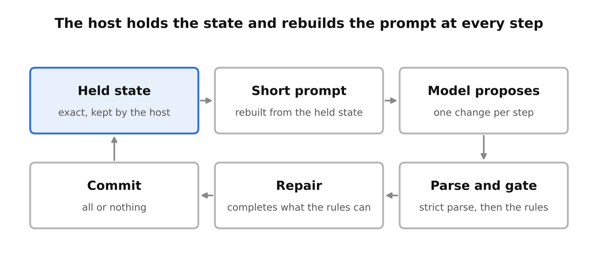
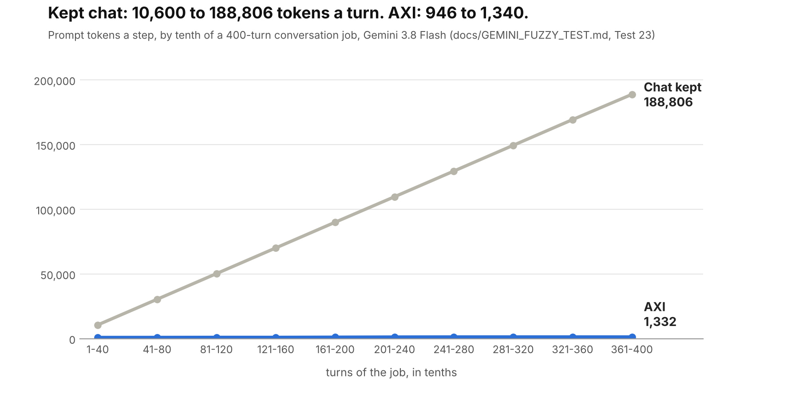

# AXI: 3,954 of 4,000 replies right, 4,000 of 4,000 states exact

On one job of 4,000 requests, Gemini 3.8 Flash's own replies were exactly right 3,954 times (98.85 percent). The state the host held was exactly right on all 4,000 steps. The model was not changed. The 46 replies that were not exactly right all left out the same thing, and a fixed rule on the host completed them. The 4,000-step figures can be recomputed from the saved replies in a few seconds, with no key; every other figure points to the page and run file that holds it.

AXI is a layer on the host side, between a model and the state it edits. It is for the company that runs the model, not for end users, and it fits any LLM application that holds state: agents, chat, workflows, short jobs and long ones, from the first step. The architecture is by **Rajnish Choubey**; the tests were built and run by **Shalendra Gaur**, working with an AI coding assistant that is a tool, not an author.

## What one incomplete reply does

One kind of request trips the model: "Delete the service at (x,y), and also remove the edge from … to …". The job had 129 of them. When the service had other edges attached to it (its dependants), the model deleted the service and the named edge and left some of the attached edges out in 46 of 97 replies. When the request only said "Delete the service", it named every dependant every time: 472 of 472.

Applied as written, one such reply leaves edges pointing at a service that no longer exists, and nothing on the host checks it again, so the state stays wrong until a later request happens to overwrite it. In the live run that applied the replies as written, the first of these came at step 16, and the state was off the right one from step 16 to step 104: 89 steps. In all 46 cases the reply was the ideal reply with items left out: nothing added, nothing changed.

With the host holding the state, the same reply meets a fixed repair rule that adds the attached edges, the commit is all or nothing, and the next prompt is built from the exact state. The model needed no new instruction for this.

(`docs/MILLION_TOKEN_TEST_HARD.md`)

## The same replies, three ways of keeping the state

Over all 4,000 steps the state the host held was exactly the right one on 4,000 and broken on none, and replaying the saved replies reproduces every saved flag of every step. The run sent 3,661,209 tokens and cost $4.95 at the prices below. The table takes the first 400 requests of the same job.

| Way of keeping the state (first 400 requests) | Steps with exactly the right state | Steps with a broken state | Dollars per step with the right state |
| --- | --- | --- | --- |
| Replies applied as written | 85 of 400 | 223 | $0.00524 (4.5 times AXI) |
| Gate only: refuse a bad reply, otherwise change nothing | 84 of 400 | 0 | $0.00573 (4.9 times AXI) |
| AXI: gate, repair, all-or-nothing commit | 400 of 400 | 0 | $0.00117 |

The first two rows are separate live runs of the same 400 requests in which the model saw its own held state, so their replies differ from the AXI run's after the first slip; the AXI row is the first 400 steps of the 4,000-step run. Prices are $0.75 in and $3.75 out per million tokens, with thinking counted as output. A check that refuses a bad reply keeps the state well formed; it does not make it right.

## How one step works



At every step the model sees a short prompt built from the held state and proposes one change in a small strict language. A reply the strict parser cannot read is refused and asked again, up to twice. The gate checks the proposal against the rules, the repair rule completes what the rules can complete (for example the edges attached to a service that is being deleted), and the commit is all or nothing: the state is the old one or the new one, never half of a change. The prompt for the next step is built from the new state, so its size follows the size of the state and not the number of steps.

## Cost and time as the job gets long



On that conversation job the chat kept sent 99,809 prompt tokens a turn on average (85 times as many as AXI's 1,177 a step); in all, 39.9 million tokens against 0.53 million for AXI, with its replies and thinking counted too (76 times fewer). With 97.0 percent of the kept chat's prompt served from the cache, its first token took a median 5.57 s once the prompt passed 150,000 tokens, against 1.86 s in its first 50 turns, where it was the faster of the two. With AXI the first token took a median 2.41 s over all 400 steps. (`docs/GEMINI_FUZZY_TEST.md`, Test 23)

The long job is heavier: a dense service graph, a block of 40 log lines with every request, and the chat kept until the next prompt would have passed 950,000 tokens.

| 1,500-step long job, Gemini 3.8 Flash | Chat kept | AXI |
| --- | --- | --- |
| Prompt tokens a step | 476,835 on average, 949,591 at most (457 turns, stopped before the next prompt would pass 950,000 tokens) | 2,824 on average, flat over all 1,500 steps (169 times fewer) |
| First token, median | 9.13 s once the prompt passed 500,000 tokens | 2.27 s over all 1,500 steps |
| State exactly right when each reply is applied as it comes | through turn 286, wrong on every turn from 287 | 1,500 of 1,500 steps |

(`docs/GEMINI_LONG_TEST.md`)

## Other models, more sessions, hostile input

The same layer ran on an open 7B model, Qwen2.5-7B-Instruct-AWQ, served with vLLM on one NVIDIA L4. Each line below is one page in the repository, with its run file and the test that recomputes the figures.

| What was run | Result | Page |
| --- | --- | --- |
| Four jobs of 20,000 steps, one L4 | 80,000 of 80,000 steps with exactly the right state; prompt about 620 tokens, 660 at most; 0.1605 s a step in the first 2,000 rounds, 0.1651 s in the last 2,000 | [`ENDURANCE_7B_TEST.md`](ENDURANCE_7B_TEST.md), Test 43 |
| 256 sessions at once on the same card | 25,557 steps, all exact; 105,230 exact steps per GPU hour; 2.458 J per exact step | [`SESSIONS_PER_CHIP_TEST.md`](SESSIONS_PER_CHIP_TEST.md), Test 38 |
| 10,000,000 hostile proposals through the gate (Python reference model, on a CPU) | none of the 1,401,041 injection proposals committed | [`GATE_STRESS_TEST.md`](GATE_STRESS_TEST.md) |

One card, one quantised model, one seed, synthetic service graphs; each page lists its own limits.

## Check it yourself

Three checks, quickest first. The first needs no key and no account.

**1. Replay the 4,000 steps (about 3 seconds, no key).** It replays the saved replies of the run and recomputes the held state with the repository's own code.

```
git clone https://github.com/gaurshalendra2412/axi-runtime
cd axi-runtime/python
python3 quickstart_replay.py
```

Or open the [one-click notebook in Colab](https://colab.research.google.com/github/gaurshalendra2412/axi-runtime/blob/main/python/colab/axi_try_it.ipynb).

**2. Run the same harness live, with your own Gemini key (a free one is enough).**

```
export GEMINI_API_KEY=your-key
pip install google-genai numpy
python3 live_check.py
```

**3. A longer live run, or another model.**

```
python3 live_check.py --steps 100 --daily-limit 0 --min-interval 0.3
python3 live_check.py --model gemini-3.5-flash-lite
```

Full instructions: [`TRY_IT.md`](TRY_IT.md).

## What has been said in public, and what was measured

The left column paraphrases public pages; the right column is one result in the repository for the same kind of cost. They are different tasks, not the sources' own benchmarks.

| Said in public | Measured with AXI |
| --- | --- |
| Cost and time to first token rise with context; stale context hurts the model; a bigger window does not fix this. [Google Developers Blog, "Architecting efficient context-aware multi-agent framework for production", 4 Dec 2025](https://developers.googleblog.com/architecting-efficient-context-aware-multi-agent-framework-for-production/) | 1,500-step job, Gemini 3.8 Flash: chat kept 476,835 prompt tokens a step on average, up to 949,591; AXI 2,824, flat (169 times fewer). First token, median 9.13 s past 500,000 tokens against 2.27 s. |
| Implicit caching passes on cost savings; the page gives no latency figure. [Gemini API documentation, "Context caching"](https://ai.google.dev/gemini-api/docs/caching) | With 97.0 percent of the kept chat's prompt cached, first token median 5.57 s past 150,000 tokens (1.86 s in the first 50 turns); AXI 2.41 s. |
| A developer reports a session growing from about 2K to over 80K tokens in five turns. [Google developer forums, ADK thread, 10 Sep 2026](https://discuss.google.dev/t/best-practices-for-handling-context-compaction-and-token-blowup-in-recursive-adk-agent-tool-loops/396215) | The prompt is built from the held state, so its size follows the state, not the step count: 7B model, 80,000 steps, prompt near 620 tokens, never above 660. |
| About 100 to 1 input to output tokens in agent loops; the KV-cache hit rate is the key production metric. [Manus, "Context Engineering for AI Agents: Lessons from Building Manus"](https://manus.im/blog/Context-Engineering-for-AI-Agents-Lessons-from-Building-Manus) | Conversation job: 39.9 million tokens with the chat kept, 0.53 million with AXI (76 times fewer). 4,000-request run: a step with the right state, replies applied as written, cost 4.5 times AXI's. |
| Across six generation tasks, performance falls 39 percent on average from single-turn to multi-turn. [Laban, Hayashi, Zhou and Neville, arXiv 2505.06120](https://arxiv.org/abs/2505.06120) | A different task: a state edited step by step. Applied as it comes, the long job's state was exact until turn 286 and wrong from 287. With AXI: 1,500 of 1,500 steps on that job, 4,000 of 4,000 on the 4,000-step run, 80,000 of 80,000 on the 7B model. |
| Context rot: recall from the window declines as it grows; compaction and structured notes are the usual answers. [Anthropic, "Effective context engineering for AI agents", 29 Sep 2025](https://www.anthropic.com/engineering/effective-context-engineering-for-ai-agents) | AXI is a third route: nothing is kept in the chat; the host holds the exact state and rebuilds a short prompt every step. The head-to-head with compaction is written and locked before its run ([`COMPACTION_TEST.md`](COMPACTION_TEST.md)); its result is not in yet. |

No company named here has reviewed or endorsed this work.

## Who made it, and what this is

The architecture is by **Rajnish Choubey**. The tests were built and run by **Shalendra Gaur**, working with an AI coding assistant that is a tool, not an author. This is not affiliated with any model provider, and it has nothing to do with ARM's AMBA AXI bus.

AXI is a layer on the host side: the model is unchanged, and every claim on this page is about the state the host holds. Most runs here are one seed and one run per arm on synthetic service graphs; each linked page lists its own limits and what would count against AXI.

Other groups build commit boundaries around agent state too, with their own settings: Cordon (arXiv 2606.17573) and MemTX (arXiv 2607.23929). These systems have not been run against each other.

**Records and code.**

- Technical report: [10.5281/zenodo.24508592](https://doi.org/10.5281/zenodo.24508592)
- White paper: [10.5281/zenodo.23958737](https://doi.org/10.5281/zenodo.23958737)
- Repository: [github.com/gaurshalendra2412/axi-runtime](https://github.com/gaurshalendra2412/axi-runtime)

Issues are welcome. If a number here does not recompute, please say so there.
